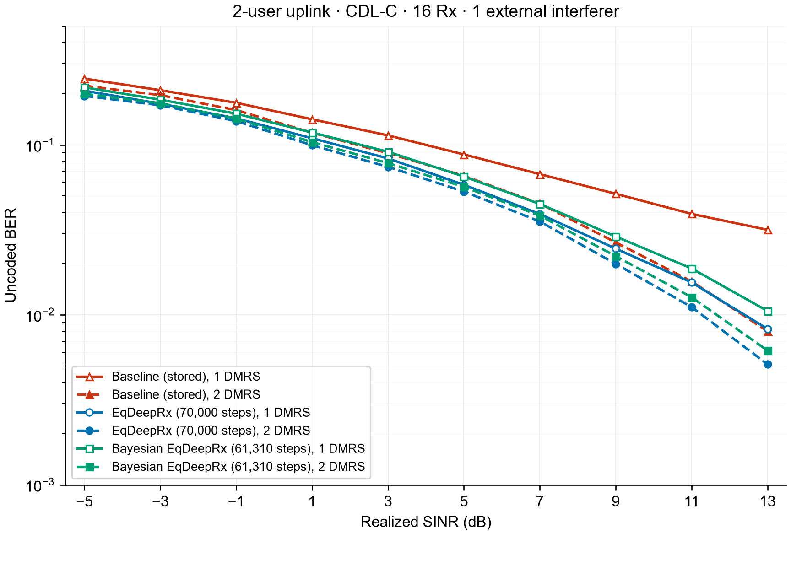
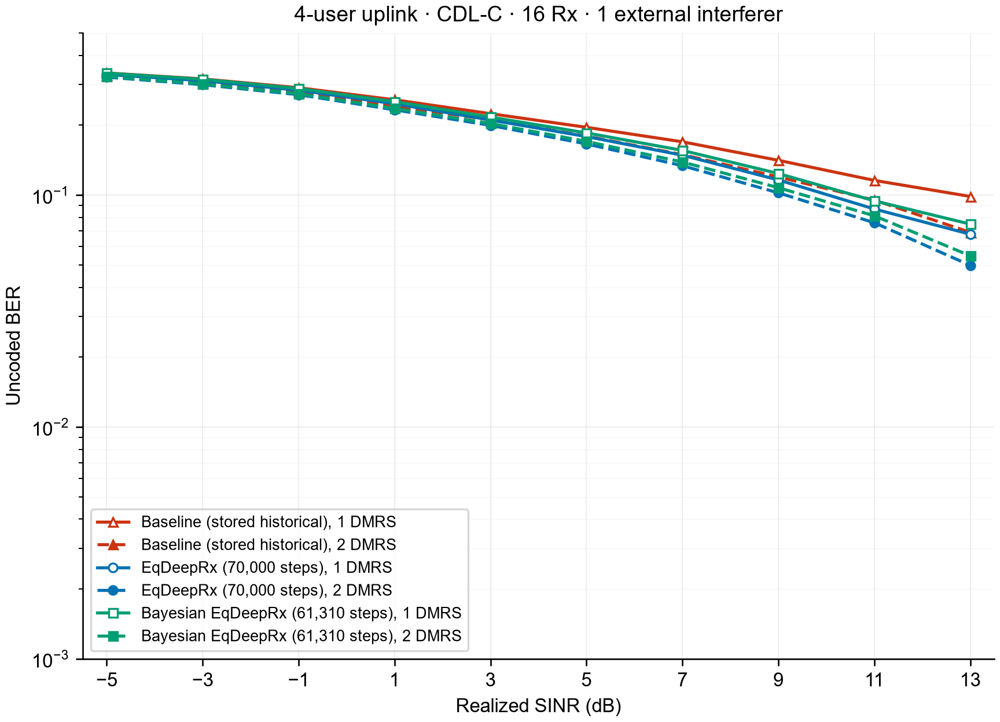

# Bayesian EqDeepRx

Bayesian EqDeepRx detects 64-QAM uplink symbols through four synchronous interactions between a convolutional state network and a joint, per-resource-element probability update. The detector receives the common front-end estimates, maintains a 64-channel state for each user, exchanges two eight-level real-symbol beliefs per user, and produces six bit log-likelihood ratios per data symbol.

## 1. Detector inputs and notation

Let $N$ be the batch size, $R$ the number of receive antennas, $K$ the number of transmitted layers, $F$ the number of subcarriers, and $S$ the number of OFDM symbols. A resource element (RE) is indexed by $(f,s)$, with zero-based frequency and time indices. The resource grid has $F=192$ and $S=14$; the receiver uses $R=16$. The layer dimension is variable.

The detector takes the following quantities from the shared front end. Channel estimation, DenoiseNN, covariance estimation, and the two parallel equalizers are outside the detector described here.

| Quantity | Symbol | Shape |
|---|---|---|
| Complex received grid | $Y$ | $N\times R\times F\times S$ |
| Estimated complex channel | $\widehat H$ | $N\times R\times K\times F\times S$ |
| Estimated complex disturbance covariance | $\widehat R$ | $N\times B\times R\times R$ |
| LMMSE symbol estimates | $X_{\mathrm L}$ | $N\times K\times F\times S$ |
| RZF symbol estimates | $X_{\mathrm Z}$ | $N\times K\times F\times S$ |
| Known complex pilot symbols, zero elsewhere | $p$ | $N\times K\times F\times S$ |
| Pilot-location mask | $\Omega$ | $N\times K\times F\times S$ |
| Binary data mask | $M$ | $N\times K\times F\times S$ |

The covariance is constant over each 24-subcarrier band and over the OFDM-symbol dimension:

$$
B=\left\lceil\frac F{24}\right\rceil,\qquad
b(f)=\left\lfloor\frac f{24}\right\rfloor.
$$

A data mask with shape $N\times1\times F\times S$ is broadcast to all $K$ layers. For every layer and RE, data and a nonzero known pilot are mutually exclusive.

The normalized 8-PAM alphabet and the corresponding 64-QAM alphabet are

$$
\mathcal A=\frac1{\sqrt{42}}\{-7,-5,-3,-1,1,3,5,7\},
\qquad
\mathcal X=\{a+\mathrm j b:a,b\in\mathcal A\}.
$$

The alphabet has mean complex-symbol energy one under uniform sampling. All state and message tensors use the channel-first ordering $[N,K,C,F,S]$. Convolutional networks merge the batch and user dimensions into $NK$ and process $[NK,C,F,S]$; their parameters are shared by all users.

## 2. Equalizer features and pilot-distance encoding

### 2.1 Six front-end feature channels

Define normalized frequency and time coordinates

$$
c_f(f)=-1+\frac{2f}{F-1},\qquad
c_s(s)=-1+\frac{2s}{S-1}.
$$

At each user and RE, the six real-valued input features are concatenated in this order:

$$
E_{n,k,:,f,s}=
\begin{bmatrix}
\Re X_{\mathrm L,n,k,f,s}\\
\Im X_{\mathrm L,n,k,f,s}\\
\Re X_{\mathrm Z,n,k,f,s}\\
\Im X_{\mathrm Z,n,k,f,s}\\
c_f(f)\\
c_s(s)
\end{bmatrix},
\qquad
E\in\mathbb R^{N\times K\times6\times F\times S}.
$$

The coordinate maps are identical for all users and batch elements.

### 2.2 Two pilot-distance channels

For each batch element and user, form the occupied pilot-time and pilot-frequency sets

$$
\mathcal T_{n,k}=\{s:\exists f,\ \Omega_{n,k,f,s}>0\},
\qquad
\mathcal F_{n,k}=\{f:\exists s,\ \Omega_{n,k,f,s}>0\}.
$$

The time and frequency distances are computed separately:

$$
d^{\mathrm{time}}_{n,k,f,s}
=\min_{\tau\in\mathcal T_{n,k}}|s-\tau|,
\qquad
d^{\mathrm{freq}}_{n,k,f,s}
=\min_{\phi\in\mathcal F_{n,k}}|f-\phi|.
$$

For either distance map $d$, calculate its population mean and standard deviation over the complete $F\times S$ grid of that batch element and user:

$$
\mu_d=\frac1{FS}\sum_{f,s}d_{f,s},
\qquad
\sigma_d=
\sqrt{\frac1{FS}\sum_{f,s}(d_{f,s}-\mu_d)^2}.
$$

The implemented standardization is

$$
\mathcal N(d)=
\begin{cases}
(d-\mu_d)/\max(\sigma_d,10^{-12}),&\sigma_d>0,\\
0,&\sigma_d=0.
\end{cases}
$$

The positional tensor places time distance before frequency distance:

$$
P=\operatorname{concat}_{C}
\bigl(\mathcal N(d^{\mathrm{time}}),\mathcal N(d^{\mathrm{freq}})\bigr)
\in\mathbb R^{N\times K\times2\times F\times S}.
$$

## 3. Convolution and normalization operators

### 3.1 Depthwise-separable spatial convolution

Every spatial convolution in StateInit and StateUpdate consists of a depthwise $3\times3$ convolution followed immediately by a pointwise $1\times1$ convolution.

For an input $V$ with $C_{\mathrm{in}}$ channels, the depthwise operation is

$$
Q_{c,f,s}
=\sum_{\delta_f=-1}^{1}\sum_{\delta_s=-1}^{1}
D_{c,\delta_f,\delta_s}\,
V_{c,f+\delta_f,s+\delta_s}.
$$

The pointwise operation is

$$
\operatorname{Sep}_{C_{\mathrm{in}}\to C_{\mathrm{out}}}(V)_{o,f,s}
=b_o+\sum_{c=1}^{C_{\mathrm{in}}}W_{o,c}Q_{c,f,s}.
$$

The depthwise convolution has one filter per input channel, uses groups equal to $C_{\mathrm{in}}$, and has no bias. The pointwise convolution has a bias. Both use stride one and dilation one. One-cell zero padding on both spatial dimensions preserves $F\times S$. There is no activation between the depthwise and pointwise operations.

### 3.2 Channel-wise LayerNorm

LayerNorm is applied independently at every batch/user/RE position over its $C$ feature channels:

$$
\mu_V=\frac1C\sum_{c=1}^{C}V_c,\qquad
v_V=\frac1C\sum_{c=1}^{C}(V_c-\mu_V)^2,
$$

$$
\operatorname{LN}(V)_c
=\gamma_c\frac{V_c-\mu_V}{\sqrt{v_V+10^{-3}}}+\beta_c.
$$

Each LayerNorm has its own trainable affine parameters $\gamma,\beta$. The activation is $\rho(z)=\max(z,0)$.

## 4. State initialization

Concatenate the six front-end channels and the two pilot-distance channels:

$$
Z^{(0)}=\operatorname{concat}_{C}(E,P)
\in\mathbb R^{N\times K\times8\times F\times S}.
$$

The initialization network has three independently parameterized separable convolutions:

$$
A_1=\rho\!\left(\operatorname{LN}^{\mathrm{init}}_1
\left(\operatorname{Sep}^{\mathrm{init}}_{8\to64}(Z^{(0)})\right)\right),
$$

$$
A_2=\rho\!\left(\operatorname{LN}^{\mathrm{init}}_2
\left(\operatorname{Sep}^{\mathrm{init}}_{64\to64}(A_1)\right)\right),
$$

$$
S^{(0)}=\operatorname{LN}^{\mathrm{init}}_3
\left(\operatorname{Sep}^{\mathrm{init}}_{64\to64}(A_2)\right).
$$

| Initialization step | Input width | Depthwise kernel/filter count | Pointwise output width | Following operations |
|---|---:|---|---:|---|
| First separable convolution | 8 | $3\times3$, 8 filters | 64 | LayerNorm, ReLU |
| Second separable convolution | 64 | $3\times3$, 64 filters | 64 | LayerNorm, ReLU |
| Third separable convolution | 64 | $3\times3$, 64 filters | 64 | LayerNorm |

Thus $S^{(0)}\in\mathbb R^{N\times K\times64\times F\times S}$. The final initialization layer has no ReLU and no residual shortcut.

Before the first outer round, each user's two eight-level message distributions are uniform:

$$
m^{(0)}_{n,k,c,f,s}=\frac18,\qquad
c=1,\ldots,16.
$$

The first eight message channels represent the real component and the next eight the imaginary component, both in ascending alphabet order.

## 5. Four outer CNN/probability rounds

There are exactly four outer rounds, indexed by $t=1,2,3,4$. Each round has its own StateUpdate parameters and its own scalar probability-initialization scale. StateInit is separate from these four rounds. StateUpdate parameters are shared across users within a round; the four rounds do not share their StateUpdate weights.

### 5.1 CNN state update

The input to round $t$ is

$$
Z^{(t)}
=\operatorname{concat}_{C}\bigl(S^{(t-1)},m^{(t-1)},P\bigr)
\in\mathbb R^{N\times K\times82\times F\times S},
$$

with $82=64+16+2$. Its three convolutions and residual connection are

$$
A^{(t)}_1=
\rho\!\left(\operatorname{LN}_{t,1}
\left(\operatorname{Sep}_{t,82\to64}(Z^{(t)})\right)\right),
$$

$$
A^{(t)}_2=
\rho\!\left(\operatorname{LN}_{t,2}
\left(\operatorname{Sep}_{t,64\to64}(A^{(t)}_1)\right)\right),
$$

$$
U^{(t)}
=\operatorname{LN}_{t,3}
\left(S^{(t-1)}
+\operatorname{Sep}_{t,64\to64}(A^{(t)}_2)\right).
$$

| StateUpdate step | Input width | Depthwise kernel/filter count | Pointwise output width | Following operations |
|---|---:|---|---:|---|
| First separable convolution | 82 | $3\times3$, 82 filters | 64 | LayerNorm, ReLU |
| Second separable convolution | 64 | $3\times3$, 64 filters | 64 | LayerNorm, ReLU |
| Third separable convolution | 64 | $3\times3$, 64 filters | 64 | Add previous 64-channel state, then LayerNorm |

The shortcut is added before the final LayerNorm. There is no ReLU after that LayerNorm.

The first two channels of $U^{(t)}$ define the complex CNN symbol proposal:

$$
\widetilde x^{(t)}_{n,k,f,s}
=U^{(t)}_{n,k,1,f,s}
+\mathrm j\,U^{(t)}_{n,k,2,f,s}.
$$

This is the proposal before the current round's probability update. For $t>1$, its inputs already contain the state and beliefs produced by earlier probability updates.

### 5.2 Active layers and known-pilot subtraction

For a fixed $(n,f,s)$, let

$$
\mathcal D=\{k:M_{n,k,f,s}>0\},\qquad K_u=|\mathcal D|.
$$

Only the layers in $\mathcal D$ are unknown data variables at that RE. Known pilot contributions from other layers are subtracted:

$$
\boldsymbol y'
=\boldsymbol Y_{n,:,f,s}
-\sum_{k\notin\mathcal D}
\widehat{\boldsymbol h}_{n,k,f,s}\,p_{n,k,f,s}.
$$

An unused nondata layer has $p_{n,k,f,s}=0$. Let $\widehat H_{\mathcal D}$ contain the active channel columns in ascending layer order. The probability block uses

$$
\boldsymbol y'=\widehat H_{\mathcal D}\boldsymbol x_{\mathcal D}
+\boldsymbol d.
$$

The graph contains the $K_u$ desired data layers. An external interferer is represented through the disturbance covariance, rather than through an additional detected symbol variable.

If $K_u=0$, the RE is not passed through the probability calculation. For any inactive layer, the returned symbol equals its CNN proposal and its 16 message entries remain $1/8$.

### 5.3 Complex-to-real observation model and disturbance variance

Stack real components before imaginary components:

$$
\boldsymbol y_{\mathbb R}
=\begin{bmatrix}\Re\boldsymbol y'\\\Im\boldsymbol y'\end{bmatrix},
\qquad
\boldsymbol x_{\mathbb R}
=\begin{bmatrix}
\Re\boldsymbol x_{\mathcal D}\\
\Im\boldsymbol x_{\mathcal D}
\end{bmatrix}.
$$

The real channel matrix is

$$
G=
\begin{bmatrix}
\Re\widehat H_{\mathcal D}&-\Im\widehat H_{\mathcal D}\\
\Im\widehat H_{\mathcal D}& \Re\widehat H_{\mathcal D}
\end{bmatrix}
\in\mathbb R^{2R\times2K_u},
\qquad
\boldsymbol y_{\mathbb R}=G\boldsymbol x_{\mathbb R}+\boldsymbol d_{\mathbb R}.
$$

For a proper complex disturbance with covariance $\widehat R_{n,b(f)}$, the corresponding full real covariance is

$$
C_{\mathbb R}
=\frac12
\begin{bmatrix}
\Re\widehat R_{n,b(f)}&-\Im\widehat R_{n,b(f)}\\
\Im\widehat R_{n,b(f)}& \Re\widehat R_{n,b(f)}
\end{bmatrix}.
$$

The implemented scalar observation factors take the diagonal complex variances

$$
v_r=\Re[\widehat R_{n,b(f)}]_{r,r},
\qquad r=1,\ldots,R,
$$

and use the real-component variances

$$
\boldsymbol\nu
=\frac12[v_1,\ldots,v_R,v_1,\ldots,v_R]^{\mathsf T}.
$$

Equivalently, their real covariance model is $\operatorname{diag}(\boldsymbol\nu)$. The factor equations below use these per-observation variances.

There are $J=2R$ real observations and $I=2K_u$ real symbol variables. Each variable $i$ takes one of the eight values in $\mathcal A$.

### 5.4 Initial directed distributions from the CNN proposal

Form the real proposal vector

$$
\widetilde{\boldsymbol x}_{\mathbb R}^{(t)}
=\begin{bmatrix}
\Re\widetilde{\boldsymbol x}_{\mathcal D}^{(t)}\\
\Im\widetilde{\boldsymbol x}_{\mathcal D}^{(t)}
\end{bmatrix}.
$$

Each round has a trainable unconstrained scalar $\xi_t$ and a positive scale

$$
\sigma_t=\operatorname{softplus}(\xi_t)+10^{-4},
\qquad
\operatorname{softplus}(z)=\log(1+e^z).
$$

All four scales are initialized to the PAM spacing:

$$
\sigma_t^{\mathrm{init}}=\frac2{\sqrt{42}},
\qquad
\xi_t^{\mathrm{init}}
=\log\!\left(\exp\!\left(\frac2{\sqrt{42}}-10^{-4}\right)-1\right).
$$

The Gaussian-distance initialization for variable $i$ is

$$
\pi_i^{(t)}(a)
=\frac{
\exp\!\left(-\frac{(\widetilde x_{\mathbb R,i}^{(t)}-a)^2}{2\sigma_t^2}\right)}
{\sum_{b\in\mathcal A}
\exp\!\left(-\frac{(\widetilde x_{\mathbb R,i}^{(t)}-b)^2}{2\sigma_t^2}\right)}.
$$

The same scalar $\sigma_t$ is shared across the batch, users, symbol components, and REs within round $t$. Initialize every observation-directed distribution by

$$
p^{[0]}_{i\to j}(a)=\pi_i^{(t)}(a),
\qquad j=1,\ldots,J.
$$

The square-bracket superscript indexes the internal probability updates, separately from the outer-round index $t$. For a candidate-logit vector $z$, the normalized softmax is evaluated in the stable form

$$
\operatorname{softmax}_{a}(z)
=\frac{\exp(z_a-z_{\max})}
{\sum_{b\in\mathcal A}\exp(z_b-z_{\max})},
\qquad
z_{\max}=\max_{b\in\mathcal A}z_b.
$$

### 5.5 Gaussian approximation of the other users' contributions

For observation $j$ and target variable $i$, the scalar observation factor is

$$
f_j(a_1,\ldots,a_I)
=\frac1{\sqrt{2\pi\nu_j}}
\exp\!\left(
-\frac{(y_{\mathbb R,j}-\sum_{\ell=1}^{I}G_{j\ell}a_\ell)^2}{2\nu_j}
\right).
$$

Before approximation, marginalizing all other symbol variables gives a candidate likelihood proportional to

$$
\rho_{j\to i}(a)
=\sum_{\boldsymbol a_{-i}\in\mathcal A^{I-1}}
f_j(a_1,\ldots,a_{i-1},a,a_{i+1},\ldots,a_I)
\prod_{\ell\ne i}p_{\ell\to j}(a_\ell).
$$

The implemented update replaces the sum of the other variables by a Gaussian with matching first and second moments. For internal pass $h=1,2$, compute from $p^{[h-1]}$:

$$
\mu^{[h-1]}_{i\to j}
=\sum_{a\in\mathcal A}a\,p^{[h-1]}_{i\to j}(a),
$$

$$
v^{[h-1]}_{i\to j}
=\max\!\left(
\sum_{a\in\mathcal A}a^2p^{[h-1]}_{i\to j}(a)
-(\mu^{[h-1]}_{i\to j})^2,\ 0
\right).
$$

The other-variable contribution has approximate mean and variance

$$
\eta^{[h]}_{ji}
=\sum_{\ell\ne i}G_{j\ell}\mu^{[h-1]}_{\ell\to j},
\qquad
u^{[h]}_{ji}
=\sum_{\ell\ne i}G_{j\ell}^{\,2}v^{[h-1]}_{\ell\to j}.
$$

The implementation evaluates these sums by forming the all-variable total and subtracting the target contribution:

$$
\eta^{[h]}_{ji}
=\sum_{\ell=1}^{I}G_{j\ell}\mu^{[h-1]}_{\ell\to j}
-G_{ji}\mu^{[h-1]}_{i\to j},
$$

$$
u^{[h]}_{ji}
=\sum_{\ell=1}^{I}G_{j\ell}^{\,2}v^{[h-1]}_{\ell\to j}
-G_{ji}^{\,2}v^{[h-1]}_{i\to j}.
$$

Define the residual and the variance used by the observation likelihood:

$$
r^{[h]}_{ji}=y_{\mathbb R,j}-\eta^{[h]}_{ji},
\qquad
V^{[h]}_{ji}=\max(\nu_j+u^{[h]}_{ji},\nu_j).
$$

The resulting Gaussian candidate factor is

$$
\widetilde\rho^{[h]}_{j\to i}(a)
=\frac1{\sqrt{2\pi V^{[h]}_{ji}}}
\exp\!\left(
-\frac{(r^{[h]}_{ji}-G_{ji}a)^2}{2V^{[h]}_{ji}}
\right).
$$

The floor by $\nu_j$ preserves a positive observation variance after floating-point total-minus-target calculations.

### 5.6 Stable likelihood ratios and exactly two internal passes

The implementation stores candidate log-likelihood ratios relative to the first alphabet element $a_0=-7/\sqrt{42}$:

$$
\Delta^{[h]}_{ji}(a)
=\log\frac{\widetilde\rho^{[h]}_{j\to i}(a)}
{\widetilde\rho^{[h]}_{j\to i}(a_0)}.
$$

Since $V^{[h]}_{ji}$ is independent of the candidate $a$, the Gaussian normalization cancels. The evaluated expression is

$$
\Delta^{[h]}_{ji}(a)
=-\frac{
(r^{[h]}_{ji}-G_{ji}a)^2
-(r^{[h]}_{ji}-G_{ji}a_0)^2}
{2V^{[h]}_{ji}}.
$$

Sum the ratios over all real observations:

$$
A^{[h]}_i(a)=\sum_{j=1}^{J}\Delta^{[h]}_{ji}(a).
$$

After the first pass, the normalized outgoing distribution excludes the target observation:

$$
p^{[1]}_{i\to j}(a)
=\frac{\prod_{j'\ne j}\widetilde\rho^{[1]}_{j'\to i}(a)}
{\sum_{b\in\mathcal A}\prod_{j'\ne j}
\widetilde\rho^{[1]}_{j'\to i}(b)}.
$$

Its log-domain implementation is

$$
p^{[1]}_{i\to j}(a)
=\operatorname{softmax}_{a\in\mathcal A}
\left(A^{[1]}_i(a)-\Delta^{[1]}_{ji}(a)\right).
$$

The second pass recomputes the moments, residuals, variances, and factors from $p^{[1]}$. The final belief combines every observation:

$$
q_i^{(t)}(a)
=\frac{\prod_{j=1}^{J}\widetilde\rho^{[2]}_{j\to i}(a)}
{\sum_{b\in\mathcal A}\prod_{j=1}^{J}
\widetilde\rho^{[2]}_{j\to i}(b)}
=\operatorname{softmax}_{a\in\mathcal A}\left(A^{[2]}_i(a)\right).
$$

The CNN distribution $\pi_i^{(t)}$ appears in the initialization $p^{[0]}$. The outgoing $p^{[1]}$ and final belief $q_i^{(t)}$ are the normalized factor products defined above.

### 5.7 Soft projection and the 16-channel belief tensor

Compute the marginal mean of each real symbol:

$$
\widehat x_{\mathbb R,i}^{(t)}
=\sum_{a\in\mathcal A}a\,q_i^{(t)}(a).
$$

For the active user occupying position $\ell$ in $\mathcal D$, reconstruct the complex estimate as

$$
\widehat x_{k}^{(t)}
=\widehat x_{\mathbb R,\ell}^{(t)}
+\mathrm j\,\widehat x_{\mathbb R,K_u+\ell}^{(t)}.
$$

If $\mathcal A=(a_1,\ldots,a_8)$ in ascending order, the message stored for that user is

$$
m_k^{(t)}
=\begin{bmatrix}
q_{\ell}^{(t)}(a_1),\ldots,q_{\ell}^{(t)}(a_8),
q_{K_u+\ell}^{(t)}(a_1),\ldots,q_{K_u+\ell}^{(t)}(a_8)
\end{bmatrix}^{\mathsf T}.
$$

Thus $m^{(t)}$ has shape $N\times K\times16\times F\times S$. The soft projection and beliefs are computed jointly over all active users at each RE.

### 5.8 Synchronous state writeback

Only the first two state channels are replaced. For an active data layer,

$$
S_{n,k,:,f,s}^{(t)}
=\operatorname{concat}_{C}
\left(
\Re\widehat x_{n,k,f,s}^{(t)},
\Im\widehat x_{n,k,f,s}^{(t)},
U_{n,k,3:64,f,s}^{(t)}
\right).
$$

For an inactive layer, the projection equals $\widetilde x^{(t)}$, so its entire state remains $U^{(t)}$ and its message is uniform. CNN processing still spans the complete grid.

All users first produce their $U^{(t)}$ proposals, then participate in the same per-RE probability calculation, and finally receive the updated states and beliefs. The next outer round uses $\bigl(S^{(t)},m^{(t)},P\bigr)$. The channel estimate and disturbance covariance are held fixed throughout the four rounds.

## 6. Pointwise residual DemapperNN

One DemapperNN is shared by all users and all outer rounds. It processes the complete 64-channel state, including both projected symbol channels and the other 62 channels.

It contains four pointwise residual blocks with widths

$$
64\longrightarrow32\longrightarrow32\longrightarrow32\longrightarrow8.
$$

For block $r$, with input $D_{r-1}$ and output width $C_r$, the two-convolution residual branch is

$$
T_r=W_{r,1}*\rho(D_{r-1})+b_{r,1},
$$

$$
D_r=W_{r,2}*\rho(T_r)+b_{r,2}+\mathcal P_r(D_{r-1}).
$$

Every convolution here is a standard $1\times1$ convolution with a bias. The shortcut $\mathcal P_r$ is the identity when input and output widths match; otherwise it is a separate biased $1\times1$ projection. The shortcut receives the block input before ReLU. There is no activation after the residual addition.

| Demapper block | Residual convolution 1 | Residual convolution 2 | Shortcut |
|---|---|---|---|
| 1 | $1\times1$, $64\to32$, after input ReLU | $1\times1$, $32\to32$, after ReLU | Biased $1\times1$, $64\to32$ |
| 2 | $1\times1$, $32\to32$, after input ReLU | $1\times1$, $32\to32$, after ReLU | Identity |
| 3 | $1\times1$, $32\to32$, after input ReLU | $1\times1$, $32\to32$, after ReLU | Identity |
| 4 | $1\times1$, $32\to8$, after input ReLU | $1\times1$, $8\to8$, after ReLU | Biased $1\times1$, $32\to8$ |

Only the first six output channels are retained for 64-QAM. Denoting the eight-channel demapper output by $D_4^{(t)}$, the masked bit outputs are

$$
L^{(t)}_{n,k,b,f,s}
=M_{n,k,f,s}\,[D_4^{(t)}]_{n,k,b,f,s},
\qquad b=1,\ldots,6.
$$

The output convention is bit-zero-positive:

$$
L_b\ \text{represents}\quad
\log\frac{\Pr(b=0\mid Y)}{\Pr(b=1\mid Y)},
\qquad
\widehat b=\mathbf{1}[L_b<0].
$$

Training computes a readout after each of the four outer rounds. Ordinary inference computes the readout only after round four and returns $L^{(4)}$. The final output shape is $N\times K\times6\times F\times S$.

## 7. Training objective

Let $b_{n,k,b,f,s}\in\{0,1\}$ be the transmitted bit labels, $x_{n,k,f,s}$ the transmitted complex symbols, and

$$
C_n=\sum_{k,f,s}M_{n,k,f,s}
$$

the number of active data symbols in slot $n$. With $s(z)=1/(1+e^{-z})$, the bit-one probability associated with the output convention is $s(-L)$.

The bit cross entropy of outer round $t$ is

$$
\mathrm{CE}^{(t)}_n
=-\frac1{6C_n}
\sum_{k,f,s}\sum_{b=1}^{6}M_{n,k,f,s}
\left[
b_{n,k,b,f,s}\log s(-L^{(t)}_{n,k,b,f,s})
+(1-b_{n,k,b,f,s})\log s(L^{(t)}_{n,k,b,f,s})
\right].
$$

The equivalent numerically stable elementwise expression used by the logits loss is

$$
\ell(L,b)
=\max(-L,0)+bL+\log(1+\exp(-|L|)).
$$

The auxiliary symbol objective is evaluated on the CNN proposals before the current round's probability update:

$$
\mathrm{SE}_n
=\sum_{t=1}^{4}\sum_{k,f,s}
M_{n,k,f,s}
\left|\widetilde x^{(t)}_{n,k,f,s}-x_{n,k,f,s}\right|^2.
$$

This is a sum over data symbols and rounds, with no division by $C_n$ and no average over rounds. Pilot and unused positions are excluded from both the bit and symbol objectives.

For per-slot linear SNR $\gamma_n=10^{\mathrm{SNR}_{n,\mathrm{dB}}/10}$, the complete loss is

$$
\mathcal L
=\frac1N\sum_{n=1}^{N}
\log_2(1+\gamma_n)
\left[
\frac14\sum_{t=1}^{4}\mathrm{CE}^{(t)}_n
+10^{-5}\mathrm{SE}_n
\right].
$$

The logits cross entropy uses natural logarithms; the SNR weighting is explicitly base two. StateInit, all four StateUpdate networks, DemapperNN, and the four $\xi_t$ are trainable. The supplied pretrained DenoiseNN is fixed.

Gradients pass through the normalized beliefs, Gaussian moments, soft projections, and subsequent outer rounds. The round-$t$ proposal precedes $\sigma_t$, so that round's own pre-projection symbol term has no direct dependence on $\sigma_t$. Symbol terms in later rounds can depend on earlier $\sigma_t$ through their input states and messages. The fourth-round scale receives its objective gradient through the bit readout.

### 7.1 LAMB parameter update

The detector is optimized with LAMB using an effective batch of 112 slots, base learning rate $4.4\times10^{-3}$, $\beta_1=0.9$, $\beta_2=0.999$, $\epsilon=10^{-6}$, zero weight decay, and bias correction.

For each trainable parameter tensor $\theta$, initialize its first and second moments to zero. At its update count $q=1,2,\ldots$, with accumulated objective gradient $g_q$, compute

$$
m_q=\beta_1m_{q-1}+(1-\beta_1)g_q,\qquad
v_q=\beta_2v_{q-1}+(1-\beta_2)g_q^2,
$$

$$
\widehat m_q=\frac{m_q}{1-\beta_1^q},\qquad
\widehat v_q=\frac{v_q}{1-\beta_2^q},\qquad
d_q=\frac{\widehat m_q}{\sqrt{\widehat v_q}+\epsilon}.
$$

The trust ratio is computed separately for each parameter tensor:

$$
r_q=
\begin{cases}
\|\theta\|_2/\|d_q\|_2,
&\|\theta\|_2>0,\ \|d_q\|_2>0
\ \text{and both norms are finite},\\
1,&\text{otherwise}.
\end{cases}
$$

With learning rate $\alpha_u$ at zero-based optimizer step $u$, the tensor update is

$$
\theta\leftarrow\theta-\alpha_u r_qd_q.
$$

For the total budget $T=70000$, the configured learning-rate schedule is

$$
\alpha_u=\alpha_0\max\!\left(0,1-\frac{u}{T-1}\right),
\qquad u=0,\ldots,T-1.
$$

All samples contributing to an effective batch are accumulated before its single optimizer update.

## 8. Complete detector sequence

1. Assemble the six equalizer/coordinate channels $E$ and the two standardized pilot-distance channels $P$.
2. Apply StateInit once to obtain $S^{(0)}$ with 64 channels and initialize the 16 message channels to $1/8$.
3. For each outer round $t=1,2,3,4$:
   - Concatenate $S^{(t-1)}$, $m^{(t-1)}$, and $P$ into 82 channels.
   - Apply that round's three-layer StateUpdate, its state shortcut, and final LayerNorm to obtain $U^{(t)}$.
   - Read $\widetilde x^{(t)}$ from the first two channels.
   - At every data RE, subtract inactive layers' known pilots, select the active channel columns, and form the real observation model.
   - Initialize the eight-level distributions with $\sigma_t$, perform the first factor calculation and normalized observation-excluding message update, then perform the second factor calculation.
   - Normalize the all-observation beliefs, take their real-symbol expectations, and assemble the complex projection and 16 message channels.
   - Replace only the first two state channels and retain the other 62 channels.
   - During training, apply the shared DemapperNN for that round's readout.
4. During ordinary inference, apply DemapperNN after the fourth round, retain its first six channels, mask nondata REs, and return $L^{(4)}$.

The spatial CNNs operate over frequency and OFDM time; the probability updates jointly connect users at the same RE. Four outer rounds contain eight internal factor calculations in total.

## 9. Results

The following figures use the Bayesian EqDeepRx checkpoint at 61,310 training steps and the stored EqDeepRx reference at 70,000 steps. Each Bayesian curve contains 32,000 independently generated slots for its DMRS setting. Both comparisons use CDL-C channels, 16 receive antennas, 64-QAM, one external interferer, and the one- and two-DMRS configurations. The horizontal axis is realized SINR; the vertical axis is uncoded BER. The reference curves are retained from the stored evaluation data.

### 16 receive antennas, 2 users

### 16 receive antennas, 4 users

